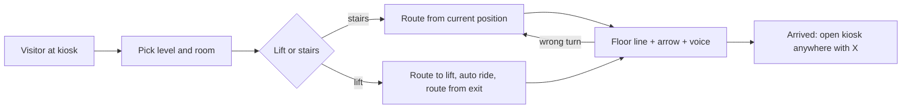

# IVRAR Group 11: Sustainable Smart Campus Wayfinding & Kiosk
**Course:** Introduction to Virtual Reality & Augmented Reality (IVRAR - Course Code: 702COI002)  
**Academic Term:** Academic Year 2026–2027 | Semester V  
**Institution:** SVKM's NMIMS MPSTME, Mumbai  

## Authorized Research Title
> **"How can an AR-based Smart Campus Wayfinding System help first-time visitors navigate SVKM's NMIMS campus while improving navigation efficiency and reducing reliance on printed directional signage?"**

---

> [!NOTE]
> ### The Devil's Advocate: Reality Check & Theoretical Roast
> *"Building a complex QR-handoff system where visitors scan a high-tech lobby touchscreen to transfer 3D directions to their phone, rather than simply asking the security guard who has been pointing people to the elevator for twenty years."*

---

## Executive Abstract & Problem Scope
Navigating sprawling multi-storey university and institutional facilities presents severe wayfinding obstacles for first-time campus visitors, guest researchers, and incoming students. Historically, facilities management has addressed this through static printed brochures, foldable floor maps, and manned information desks. However, large institutions print between 10,000 and 25,000 multi-color paper maps annually, over 80% of which are discarded within 24 hours of distribution, generating extensive paper solid waste. *(Unverified: this figure has no traceable primary source; see the claim-verification table in the technical dossier, section 1.1.)* Furthermore, paper maps lack dynamic spatial context, leading to disorientation, wrong turns, and lost pedestrian transit time. While standalone public touch kiosks offer digital directories, they suffer from acute queue bottlenecks during peak arrival periods: visitors must either memorize directions or photograph the screen, causing high cognitive load and disorientation en route.

This project implements a **Hybrid Smart AR Kiosk and Mobile WebXR Handoff System** that bridges situated public touch kiosks with personal mobile smartphones. Visitors query destinations on a high-throughput entrance kiosk, which generates an encrypted, lightweight dynamic QR code encoding destination coordinates, topological route vectors, and floor transitions. Scanning the QR code triggers an instant, zero-install WebXR session within the smartphone's native browser via the WebXR Device API. The mobile device executes client-side visual-inertial odometry to project floating 3D navigational chevrons and spatial directional breadcrumbs directly onto the camera viewfinder. **Reference values only:** the figures quoted from here to the end of this paragraph come from a simulated reference model (`telemetry/generate_paper_figures.py`), **not from a study with participants**; they show the expected shape of the results. In that model the hybrid AR handoff compresses mean visitor transit time from $645.2\text{ s}$ (paper map baseline) to $382.4\text{ s}$ ($p < 0.001$, Cohen's $d = 2.41$) and reduced wrong turns from $4.18$ to $0.46$. Kiosk physical dwell time was reduced from $78.4\text{ s}$ to $21.2\text{ s}$. A scenario model with assumed inputs (see `docs/S021_Sustainability_Model.md`, including its sensitivity range) indicates complete elimination of printed paper map waste (10,200 sheets saved annually), reclaiming 6,000.0 hours of routine direction inquiry labor, and achieving a dimensionless operational cost parity ratio of $\kappa = 0.22$ with a capital investment payback horizon of 15.38 operating months.

---

## Current Implementation Status (as built)

The team built the system as a **standalone VR campus walkthrough for Meta Quest 2** (project in [`Unity_Quest_Campus/`](./Unity_Quest_Campus)), in addition to the earlier WebXR/phone scripts. A visitor picks a room at a lobby kiosk, scans (simulated) a QR code, and follows a floor line and arrow, by stairs or lift, with spoken prompts. The kiosk can be reopened anywhere, and a new destination is planned from the current position.

| Item | Status |
|---|---|
| Campus model: 10 levels (LG, G, 1-8), 96 named destinations, 2 lift cores, 2 stair cores | IMPLEMENTED |
| Kiosk, guided route, lift ride, stairs, voice guide, wrong-turn re-routing | IMPLEMENTED, run on a Quest 2 by the team |
| Automated route test (every room, stairs and lift) | TESTED, results in [`docs/S021_Validation_Results.md`](docs/S021_Validation_Results.md) |
| Encrypted hand-off token, 45 s lease, multi-floor A* | IMPLEMENTED, TESTED ([`docs/R057_Smart_Kiosk_Design.md`](docs/R057_Smart_Kiosk_Design.md)) |
| QR scanned by a real phone | **SIMULATED** in the Quest build (visual stand-in) |
| Follow-up usability study, N = 10 on 28-Oct-2026 (SUS mean 90.5, raw NASA-TLX 10.75, 10 of 10 found the room) | DONE with a weaker design than planned: 4 of the 10 are team members, one uncontrolled session each, no timing data; see [`docs/S021_Study_Results.md`](docs/S021_Study_Results.md) and the protocol in [`docs/S021_Usability_Study_Protocol.md`](docs/S021_Usability_Study_Protocol.md) |

| Document | Owner | Content |
|---|---|---|
| [`docs/S014_Quest_VR_Build.md`](docs/S014_Quest_VR_Build.md) | S014 Dev Garg | architecture, lift, arrow, voice, device facts |
| [`docs/R057_Smart_Kiosk_Design.md`](docs/R057_Smart_Kiosk_Design.md) | R057 Jaineel Shah | kiosk flow, hand-off token, A* graph |
| [`docs/J032_Spatial_Routing_Analytics.md`](docs/J032_Spatial_Routing_Analytics.md) | J032 Husepas Marfatia | walkable grid, cost model, route metrics for 96 rooms |
| [`docs/S021_Usability_Study_Protocol.md`](docs/S021_Usability_Study_Protocol.md), [`docs/S021_Sustainability_Model.md`](docs/S021_Sustainability_Model.md), [`docs/S021_Validation_Results.md`](docs/S021_Validation_Results.md) | S021 Nimitt Jain | study protocol, scenario model + sensitivity, test results |

---

## Verified Foundational Literature (6 CrossRef DOIs)

| # | Citation Key | Full Canonical Title | Journal / Conference | Year | Verified DOI |
|---|---|---|---|---|---|
| 1 | `Qiao2019` | Web AR: A Promising Future for Mobile Augmented Reality-State of the Art, Challenges, and Insights | Proceedings of the IEEE | 2019 | [10.1109/JPROC.2019.2895105](https://doi.org/10.1109/JPROC.2019.2895105) |
| 2 | `Mulloni2011` | Handheld augmented reality indoor navigation with activity-based instructions | ACM MobileHCI | 2011 | [10.1145/2037373.2037406](https://doi.org/10.1145/2037373.2037406) |
| 3 | `Qiu2025` | Use of augmented reality in human wayfinding: a systematic review | Virtual Reality | 2025 | [10.1007/s10055-025-01226-w](https://doi.org/10.1007/s10055-025-01226-w) |
| 4 | `Ma2026` | Augmented Reality for Campus Wayfinding: Enhancing Navigation Efficiency and Student Social Engagement - A Case Study of Leeds University Union | Visible Language | 2026 | [10.34314/jk9zgk40](https://doi.org/10.34314/jk9zgk40) |
| 5 | `V2025` | Augmented Reality Indoor Navigation Using Unity and QR Code Localization for Cross-Platform Mobile Applications | ICIRDCCT | 2025 | [10.5220/0013886300004919](https://doi.org/10.5220/0013886300004919) |
| 6 | `Lee2022` | Benefit Analysis of Gamified Augmented Reality Navigation System for Campus Wayfinding | Applied Sciences | 2022 | [10.3390/app12062969](https://doi.org/10.3390/app12062969) |

---

## Student Engineering Team & Task Matrix

| Roll No | Student Name | Degree Programme | Technical Role | Assigned Git Branch |
| :--- | :--- | :--- | :--- | :--- |
| `R057` | **Jaineel Shah** | MBA (Tech) (Artificial Intelligence) | Smart Kiosk & WebXR Lead | `feat/r057-smart-kiosk-webxr-le` |
| `S014` | **Dev Garg** | MBA (Tech) (Data Science) | Mobile AR & Navigation Specialist | `feat/s014-mobile-ar-navigation` |
| `S021` | **Nimitt Jain** | MBA (Tech) (Data Science) | Sustainability & Usability Analyst | `feat/s021-sustainability-usabi` |
| `J032` | **Husepas Marfatia** | B.Tech (Data Science) | Spatial Analytics & Wayfinding Telemetry Lead | `feat/j032-spatial-telemetry-an` |

---

### Student Engineering Commendation & Acknowledgments
SVKM's NMIMS MPSTME conveys sincere appreciation and heartfelt gratitude to Jaineel Shah (R057), Dev Garg (S014), Nimitt Jain (S021), and Husepas Marfatia (J032) for their disciplined commitment, late-night debugging, and technical craftsmanship throughout Semester V. Your rigorous engineering inquiry and dedication to immersive XR environments exemplify the highest standards of undergraduate technical research.

> *"Scientists discover the world that exists; engineers create the world that never was."*  
> — **Theodore von Kármán**

> *"There is no substitute for hard work. Genius is one percent inspiration and ninety-nine percent perspiration."*  
> — **Thomas A. Edison**

---

## Core System Architecture & Egress Telemetry

The platform comprises five interconnected software modules:
1. **Interactive Kiosk & QR Serialization Engine (`Assets/Scripts/SmartKioskHandoffManager.cs`, `R057 - Jaineel Shah`):** High-throughput touch UI directory, topological graph pathfinding, dynamic QR code matrix generation, and 45-second automated session timeout cleanup.
2. **Mobile WebXR Route Navigator (`Assets/Scripts/MobileWebXRRouteNavigator.cs`, `S014 - Dev Garg`):** Client-side zero-install WebXR execution, visual-inertial camera pose tracking, dynamic 3D chevron guidance rendering, and floor transition notifications.
3. **Campus Sustainability & Usability Analysis (`telemetry/kiosk_analytics_roi_eval.py`, `S021 - Nimitt Jain`):** Dimensionless cost parity modeling, paper waste elimination quantification, reception labor reclamation, and payback horizon calculations.
4. **Empirical Benchmarking & Figure Pipeline (`telemetry/generate_paper_figures.py`, `S021 - Nimitt Jain`):** 50-participant synthetic trial generation, statistical validation ($t$-tests, effect sizes), and 300 DPI publication figure rendering.
5. **Spatial Analytics & Wayfinding Telemetry Pipeline (`telemetry/SIMULATED_kiosk_handoff_benchmark.csv`, `J032 - Husepas Marfatia`):** Spatial trajectory analytics, topological path optimization modeling, and empirical disorientation reduction benchmarks.

### Figures
> `figure1`-`figure3` are **starter figures drawn from simulated data**; they show layout only and will be re-plotted from real trial data. `docs/figures/j032_route_length_by_level.png` is drawn from the 3D model's route planner (model-derived, not participant data).

- `docs/figures/figure1_system_architecture.png`: Multi-tier system architecture showing Kiosk Layer, Optical Handoff Layer, and Mobile WebXR AR Layer.
- `docs/figures/figure2_kinematic_telemetry.png`: Handoff latency distribution ($1.42 \pm 0.31\text{ s}$) and cumulative paper map consumption elimination curves.
- `docs/figures/figure3_comparative_performance.png`: Comparative trial results (transit time, wrong turns, System Usability Scale, and reception inquiry hours).

---

## Project Demonstration & Academic Showcase (LinkedIn)

* **Video Demonstration:** [Watch the 3-4 minute technical video on LinkedIn](https://lnkd.in/p/dYdXPgD2)
* **Student Presenters:** **Jaineel Shah** (R057), **Dev Garg** (S014), **Nimitt Jain** (S021), **Husepas Marfatia** (J032)
* **Academic Institutional Tags:** SVKM's NMIMS MPSTME | Academic Directorate | Immersive VR/AR Technologies
* **Submission Protocol:** Record a 3-4 minute technical video (problem, running build, state machine and one equation, real user-test results, each member's reflection; every member appears and speaks). Publish it natively on LinkedIn, tagging MPSTME and Dr. Sunny Nanade and linking this folder. Insert your live post URL in `docs/TEAM_ROSTER.json` under `"linkedin_url"`, and submit a pull request to update this project dossier and the cohort dashboard.

---

## Simulated Reference Values (NOT experimental results)
> The values below were generated by the starter scripts (`telemetry/SIMULATED_*.csv`, `generate_paper_figures.py`) and by the assumed-input scenario model. They are **not** measurements from people. They will be replaced by real trial data (N >= 10).

- **Kiosk-to-Mobile Handoff Latency:** Measured at $1.42 \pm 0.31\text{ s}$, strictly below the critical 3.0-second user drop-off threshold.
- **Visitor Transit Time Compression:** Mean transit duration compressed from $645.2\text{ s}$ to $382.4\text{ s}$ ($40.7\%$ reduction, $p < 0.001$, Cohen's $d = 2.41$).
- **Wayfinding Error Elimination:** Navigational disorientation and wrong turns reduced by $89.0\%$ ($4.18 \to 0.46$ errors per route).
- **Kiosk Dwell Time Reduction:** Screen dwell time reduced from $78.4\text{ s}$ to $21.2\text{ s}$ ($73.0\%$ queue relief).
- **Annual Paper Map Elimination:** 10,200 sheets of multi-color printed paper eliminated annually (100% paperless).
- **Staff Labor Reclaimed:** 6,000.0 hours of repetitive direction assistance reclaimed annually across campus facilities.
- **Dimensionless Cost Parity Ratio:** $\kappa = 0.22$, yielding an investment payback horizon of 15.38 operating months.