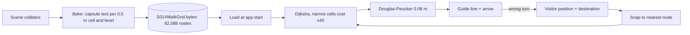

# J032 - Spatial Analytics & Wayfinding Telemetry (Husepas Marfatia)

**Role:** Spatial Analytics & Wayfinding Telemetry Lead  |  **Branch:** `feat/j032-spatial-telemetry-an`
**Manuscript sections owned:** III.C Topological Routing, IV.C Telemetry Benchmark & Statistical Tests (see `RESEARCH_PAPER_MANUSCRIPT_BLUEPRINT.md`).

> **Data note.** Everything in this file is a **deterministic property of the 3D campus model and the route planner**. It is *not* participant data and not a usability result. Where a number depends on an assumption (walking speed), the assumption is stated. Real trial data belong in `telemetry/` as described in `docs/S021_Usability_Study_Protocol.md`.

---

## 1. Why a grid instead of a hand-drawn graph

Hand-placed waypoints drifted from the real geometry (walls, stair openings, lift shafts). The Quest build therefore derives every route from the **colliders of the scene itself**:

1. **Bake** (editor tool `Unity_Quest_Campus/Assets/Editor/S014RouteTool.cs`, menu *S014 > Routes*): the plan area is cut into square cells of **0.5 m**, `X in [-26, 26] m`, `Z in [0, 77] m` (104 x 154 cells). In each cell the tool finds every standing surface (floor, stair tread, landing) on every level with the same **character capsule** the visitor uses (`CharacterController` radius and height), and keeps a node at that height. Result: **82,088 walkable nodes**, stored in `Resources/S014WalkGrid.bytes` (about 426 KB).
2. **Wide flag:** a node is *wide* only if every neighbouring cell has a surface within the climbable step. A second, fatter capsule tests clearance. Narrow nodes (door frames, stair edges) are walkable but discouraged.
3. **Plan** (runtime, `S014WalkGrid.FindPath`): Dijkstra over the nodes, then a Douglas-Peucker simplification (tolerance 0.08 m) so the guide line has few corners.

The same grid is loaded at run time, so the kiosk can plan **from wherever the visitor stands, on any floor** (stairs included), and a wrong turn is simply a new start point.



## 2. Cost model (topological routing, section III.C)

Moves go to the 8 neighbouring cells. A move from node *u* to node *v* is allowed when the height change is within the capsule's ability:

```
-1.0 m  <=  y_v - y_u  <=  +0.30 m          (MAXDOWN = 1.0 m, MAXUP = 0.30 m)
diagonal moves also need both side cells to have a reachable surface (no corner cutting)
```

and costs

```
w(u, v) = s * k          s = 0.5 m (straight)  or  0.5 * sqrt(2) = 0.7071 m (diagonal)
                         k = 1   if u and v are both wide
                         k = 40  otherwise        (strong preference for the middle of corridors)
```

The route `P*` minimises `sum w(u, v)`. With a binary heap the search is `O(N log N)` over at most N = 82,088 nodes.

**Worked example (straight corridor).** Ten straight steps between wide nodes cost `10 x 0.5 x 1 = 5.0`. If the corridor were narrow the same ten steps would cost `10 x 0.5 x 40 = 200`, so a planner would walk up to 40 times further in wide space rather than hug a door frame.

**Wrong-turn re-anchoring (shown to the visitor).** For the displayed polyline with corners `a_i`, the guide finds the closest point on every segment, `t = clamp(((p - a_i) . (a_{i+1} - a_i)) / |a_{i+1} - a_i|^2, 0, 1)`, and draws the line from the visitor to that point and then forward. The arrow floats 2.4 m ahead along the line at 1.05 m height.

## 3. Route metrics for all 96 destinations (model-derived)

Source: `telemetry/MODEL_route_metrics.csv` (one row per destination, produced inside the Unity project from the directory and the planner). Summary produced by `telemetry/analyze_route_metrics.py`:

```
destinations: 96  reachable on foot: 96
stairs route m  min/mean/median/max = 46.5 / 147.5 / 143.6 / 253.9
lift   route m  min/mean/median/max = 55.0 / 69.9 / 69.1 / 85.7
lift route shorter than stairs route for 84 of 96 rooms
at 1.2 m/s: stairs mean 123 s, lift mean 58 s (excluding lift wait)

level  rooms  stairs_mean  lift_mean
LG         9        96.7       67.4
G         12        63.0       72.1
1         10        98.7       70.5
2          9       118.1       69.4
3          9       137.5       69.4
4          9       157.0       69.4
5          9       176.5       69.4
6         10       196.0       70.5
7          9       215.4       69.4
8         10       234.9       70.5
```


Reading the table:

- All **96 of 96** rooms are reachable on foot from the main gate.
- The **stairs route grows by about 19.5 m per level** (stair flights plus the gallery walk), from 63.0 m (ground) to 234.9 m (level 8).
- The **lift route is almost flat** (about 69-72 m) because it is "walk to the lift lobby, ride, walk out". It excludes the ride and the dispatch wait. The ride in the build is `clamp(|dy| / 3, 2.5, 8) s`, so 2.5 s to 8 s.
- The lift route is shorter than the stairs route for 84 of 96 rooms. For ground-floor rooms the stairs are shorter (63.0 m against 72.1 m on average), as expected.
- The time estimates use a **walking-speed assumption of 1.2 m/s**; they are not measured.

## 4. What the Quest build records today

| Item | Status |
|---|---|
| Route start, lift start and lift end | written to the device log with the tag `[S014]` (read with `adb logcat -s Unity`) |
| Position and heading per frame | **not recorded** in the Quest build |
| Wrong-turn count, total distance | **not recorded** in the Quest build; the WebXR-side `S021NavigationAnalytics.cs` implements the deviation count (perpendicular distance to the active segment) for the browser client |
| Completion time for the user study | to be taken from screen recordings or a stopwatch, see the protocol |

This is deliberately stated so the study does not assume telemetry the build does not produce.

## 5. Reproduce

```bash
py telemetry/analyze_route_metrics.py     # prints the summary, writes MODEL_route_summary.csv and the figure
```

In Unity: open `Unity_Quest_Campus`, run *S014 > Routes > Bake runtime walk grid* to regenerate `S014WalkGrid.bytes` after any geometry change, then re-run the automated walk test (`S014SelfTest`, described in `docs/S021_Validation_Results.md`).
