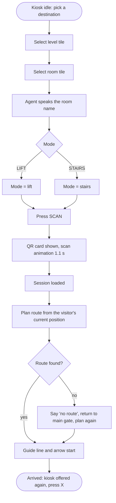

# R057 - Smart Kiosk & Handoff Design (Jaineel Shah)

**Role:** Smart Kiosk & WebXR Lead  |  **Branch:** `feat/r057-smart-kiosk-webxr-le`
**Scope (from `RESEARCH_AND_IMPLEMENTATION_GUIDE.md`, section 2.1):** kiosk touch directory, multi-floor pathfinding graph, dynamic QR payload, session encryption, 45-second lease, kiosk dwell time below 25 s.

> Status legend used in this file: **IMPLEMENTED** (code exists and was run), **TESTED** (a check was executed, output below), **SIMULATED** (visual stand-in, not the real mechanism), **NOT MEASURED** (needs the user study).

---

## 1. What the kiosk does

The kiosk stands in the ground-floor lobby of the VR campus (`Unity_Quest_Campus/Assets/S014_MobileAR/CampusVR/S014CampusKiosk.cs`). A visitor:

1. picks a **level** (LG, G, 1-8) on the floor tiles,
2. picks a **room** (96 destinations in the directory),
3. chooses **LIFT** or **STAIRS**,
4. presses **SCAN** (QR hand-off), and the guided route starts.

The visitor points with the right Meta Quest controller and pulls the trigger; in the Unity editor the mouse and **Space** do the same. Pressing **X** on the left controller summons the kiosk beside the visitor at any point of the route, so a new destination is planned **from the current position** (not from the main gate). The Reset tile was removed from the kiosk; the **Y** button is the hidden reset.

### 1.1 Kiosk flow



### 1.2 State machine

The dossier names the states *Kiosk idle -> Destination chosen -> QR generated -> Phone handoff -> Navigating -> Arrived*. They map to the code as follows.

| Dossier state | Quest build (`S014CampusKiosk`) | Starter scaffold (`SmartKioskHandoffManager.HandoffState`) |
|---|---|---|
| Kiosk idle | `SelectedId == null`, text "Pick a destination" | `IdleOverview` |
| Destination chosen | `Select(id)` stores `SelectedId`, QR card appears | `DestinationSelected` |
| QR generated | QR card visible (visual pattern) | `QRCodeAwaitingScan` (token created by `GenerateHandoffQR`) |
| Phone handoff | `ScanSequence` (1.1 s animation then "QR scanned - OK") | `HandoffCompleted` (via `TryOpenHandoff`) |
| Navigating | `S014CampusWayfindingGuide.IsActive` | - |
| Arrived | `OnArrived` banner, kiosk can be summoned | back to `IdleOverview` |

---

## 2. Hand-off token (QR payload and encryption)  - IMPLEMENTED and TESTED

File: `Assets/Scripts/HandoffPayloadCodec.cs` (pure C#, no Unity types).

| Step | Detail |
|---|---|
| Plaintext | version (1 byte), issue time (unix s), floor, kiosk id, destination id, waypoints |
| Compression | waypoints in centimetres, **delta-coded** against the previous point, **zig-zag + varint** (a 90-waypoint route is a few hundred bytes) |
| Encryption | **AES-256-CBC**, random 16-byte IV, keys derived with SHA-256 from the shared secret and a label (`enc` / `mac`) |
| Integrity | **HMAC-SHA256** over `IV | ciphertext`, first 16 bytes kept (encrypt-then-MAC), compared in constant time |
| Lease | the token is rejected after `ttlSeconds` (default **45 s**, `qrSessionTimeoutSeconds`) or if issued in the future |
| Wire form | base64url, placed in the address `.../nav?kiosk=<id>&t=<token>` |

`SmartKioskHandoffManager.GenerateHandoffQR(destinationId)` builds the payload from the A* route (section 3), encrypts it and returns the address; `TryOpenHandoff(token, ...)` is the mobile-side acknowledgement listener (decrypt, verify, check lease, then `ConfirmMobileHandoffReceived`).

**Limit to state honestly:** the secret is a demonstration key held by the kiosk. A deployed system would keep it server-side. The Quest build does not need to decrypt anything because the "phone" is simulated (section 5).

### 2.1 Check run (`dotnet run --project tools/handoff_codec_check`)

```
PASS  round trip decodes
PASS  waypoints survive within 1 cm (max error 0.01 cm)
INFO  token length for a 90-waypoint route: 598 characters (QR version 40-L holds 2953 bytes)
PASS  token fits a QR code
PASS  accepted at the 45 s limit
PASS  rejected after 46 s (expired)
PASS  rejected when issued in the future
PASS  rejected with the wrong secret
PASS  rejected when one character is tampered
PASS  rejected when truncated
PASS  rejected when not base64
PASS  two tokens of the same payload differ (random IV)
PASS  plaintext destination id is not visible in the token
PASS  A* picks the cheaper stair route (cost 28.0, expected 28.0)
PASS  A* switches to the lift when the stairs are far (cost 56.77, expected 56.77)
PASS  unreachable goal returns null
ALL CHECKS PASSED
```

---

## 3. Multi-floor path (topological graph + A*)  - IMPLEMENTED and TESTED

File: `Assets/Scripts/CampusGraph.cs`. Vertices are decision points (junctions, stair landings, lift lobbies, room entrances); edges are walkable links. The edge cost follows the guide, section 1.2:

```
W(u, v) = || p_u - p_v ||  +  gamma_floor * | floor_u - floor_v |  +  [lift edge] * liftWait * walkSpeed
f(v)    = g(v) + h(v),     h(v) = || p_v - p_dest ||           (admissible: every extra term is non-negative)
```

Defaults: `gamma_floor = 6 m` per storey, `liftWait = 20 s`, `walkSpeed = 1.2 m/s`. These are **modelling assumptions**, not measurements; they should be replaced by values from the user study.

**Worked example (also an automated check).** Kiosk K, destination D one storey up. Stairs: K to S0 = 10 m, S0 to S1 = 4 m + 6 m (one floor) = 10 m, S1 to D = 8 m, total **28.0 m**. Lift: K to L0 = 12 m, L0 to L1 = 4 + 6 + 20 x 1.2 = 34 m, L1 to D = 10.8 m, total 56.8 m. A* returns the stairs at cost 28.0. When the stairs are moved 40 m away, the stairs cost 81.05 m, the lift 56.77 m, and A* switches to the lift.

In the **Quest build** the walk-through itself is planned over a baked walkable grid (Dijkstra, see `docs/J032_Spatial_Routing_Analytics.md`); the graph above is the kiosk-side planner for the hand-off token.

---

## 4. Directory and interaction facts (from the scene)

| Item | Value |
|---|---|
| Destinations | 96 rooms on 10 levels (LG, G, 1-8) |
| Modes | LIFT, STAIRS (every room reachable on foot: 96/96) |
| Kiosk input | right controller ray + trigger; X summons the kiosk; Space / mouse in the editor |
| Voice | agent speaks the room name, "QR scanned", route start, lift and arrival prompts (pre-generated clips) |
| Source files | `S014CampusKiosk.cs`, `S014KioskButton.cs`, `S014CampusDirectory.cs`, `S014CampusPointer.cs`, `Materials/Kiosk*.mat` |

---

## 5. Traceability to the assigned tasks

| Assigned task (guide 2.1 / TODO in `SmartKioskHandoffManager.cs`) | Status | Where |
|---|---|---|
| Destination selection UI | IMPLEMENTED | `S014CampusKiosk.cs` (Quest build) |
| 3D path preview | IMPLEMENTED | route line + arrow, `S014CampusWayfindingGuide.cs` |
| Dynamic QR payload generation | IMPLEMENTED, TESTED | `HandoffPayloadCodec.Encode`, `GenerateHandoffQR` |
| Session encryption | IMPLEMENTED, TESTED | AES-256-CBC + HMAC-SHA256 |
| 45-second automatic clean-up | IMPLEMENTED, TESTED | `Update()` timer + `TryDecode` lease |
| Multi-floor pathfinding graph | IMPLEMENTED, TESTED | `CampusGraph.ShortestPath` |
| Ingest destination nodes from the spatial model | IMPLEMENTED | `InitializeDestinationDirectory` builds the graph from the destination records |
| Kiosk dwell time below 25 s | **NOT MEASURED** | needs the user study (`docs/S021_Usability_Study_Protocol.md`) |
| QR scanned by a real phone | **SIMULATED** | the Quest kiosk shows a deterministic block pattern (FNV-1a hash of the room id) and animates a scan; it is **not** an ISO/IEC 18004 symbol. The token above is what a real QR would carry. |

No participant data are reported in this file.
