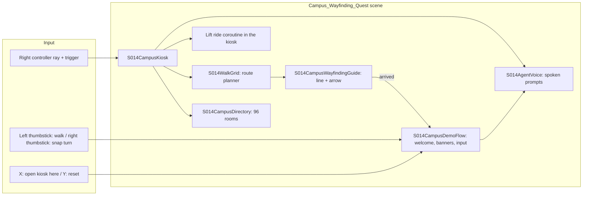
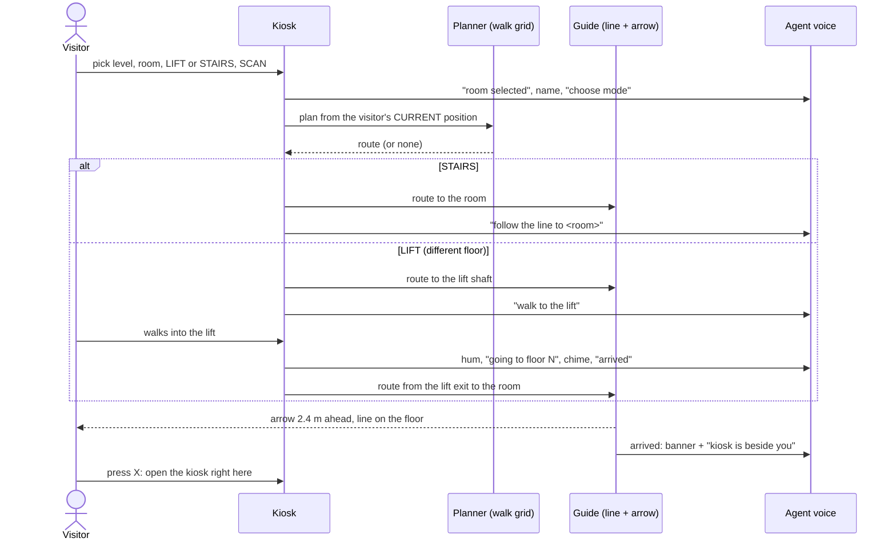

# S014 - Quest VR Campus Build (Dev Garg)

**Role:** Mobile AR & Navigation Specialist  |  **Branch:** `feat/s014-mobile-ar-navigation`
**What this is:** the standalone Meta Quest 2 build of the NMIMS MPSTME campus (10 levels, 96 destinations) with a kiosk, guided routes, lifts, stairs and a voice guide. The project is in `Unity_Quest_Campus/`. Earlier S014 work (WebXR / phone navigation helpers in `Assets/Scripts/`) is unchanged and documented in `docs/S014_MobileAR_Architecture.md`.

> Status words: **IMPLEMENTED** (in the build), **TESTED** (a test was run, see section 6), **SIMULATED** (stand-in for a real mechanism), **NOT MEASURED** (needs the user study). No participant data are reported here.

---

## 1. System at a glance

| Script (`Assets/S014_MobileAR/CampusVR/`) | Responsibility |
|---|---|
| `S014CampusDemoFlow.cs` | welcome when the headset is worn, input polling (X / Y), arrival banner and spoken arrival |
| `S014CampusWayfindingGuide.cs` | draws the route line, floats the arrow, tracks distance, detects arrival, re-anchors after a wrong turn |
| `S014CampusFreeLocomotion.cs`, `S014VRInput.cs` | thumbstick walking, snap turn, gravity, XR controller reads |
| `S014AgentVoice.cs` | plays pre-generated voice clips in sequence, lift hum and chime |
| `S014CampusKiosk.cs`, `S014CampusDirectory.cs`, `S014CampusPointer.cs`, `S014KioskButton.cs` | kiosk (see `docs/R057_Smart_Kiosk_Design.md`) |
| `S014WalkGrid.cs`, `Resources/S014WalkGrid.bytes`, `Editor/S014RouteTool.cs` | route planner (see `docs/J032_Spatial_Routing_Analytics.md`) |
| `Editor/S014SelfTest.cs` | automated walk-through test (see `docs/S021_Validation_Results.md`) |

## 2. Visitor flow

### 2.1 Lift behaviour

- The lift banks stand at the railing (atrium) edge, `z = 32..38` on every floor. The shaft centre is `(x = 0, z = 35)`, the exit on a floor is `(0, y, 30.5)`.
- Stepping within **1.4 m** of the shaft centre at floor level starts the ride automatically. A confirm panel remains as a fallback.
- The rig is moved vertically with the character controller disabled during the ride. Duration `t = clamp(|dy| / 3, 2.5, 8)` seconds (a 4 m storey takes 2.5 s; the full 36 m run takes 8 s). A soft hum plays during the ride and a chime on arrival.
- If the visitor is already on the destination floor, no lift is used even in LIFT mode.

### 2.2 Wrong turns and the arrow

For a polyline route `a_0 ... a_n` and visitor position `p`, the guide finds the closest point `q` on every segment (`t = clamp((p - a_i) . (a_{i+1} - a_i) / |a_{i+1} - a_i|^2, 0, 1)`, with a small penalty on height difference) and draws `p -> q -> a_{k+1} ...`. After a wrong turn the line therefore leads straight back onto the route. The arrow sits **2.4 m ahead along the line at 1.05 m height** and points along the segment direction. Arrival is declared inside `arrivalRadius` of the gate (horizontal distance); the scene sets **1.8 m** (the script default is 1.6 m).

### 2.3 Voice

119 short clips in `Resources/Voice/`: 96 room names, 13 phrases and 10 floor names, generated once with Windows speech (Microsoft Zira) and played sequentially through a 2D audio source, so no network or speech engine is needed on the headset. The welcome plays after the headset is detected as worn.

## 3. Mapping to the assigned S014 tasks

| Assigned task (guide section 2.2 / TODO in `MobileWebXRRouteNavigator.cs`) | Where it is done | Status |
|---|---|---|
| Mobile client execution (WebXR) | `S014WebXRPoseAdapter.cs`, `S014NavigationController.cs` and helpers (earlier PRs) | IMPLEMENTED |
| Camera pose update and floating arrow | WebXR: `S014DirectionArrow.cs` (SLERP, alpha 0.25); Quest: arrow in `S014CampusWayfindingGuide.cs` | IMPLEMENTED |
| Waypoint arrival radius below 1.5 m | `S014NavigationController.waypointArrivalRadius = 1.4 m`; Quest `arrivalRadius` = 1.8 m in the scene | IMPLEMENTED. The Quest value (1.8 m) is above the 1.5 m target of the guide; this is a documented deviation from that target |
| Floor transition alerts | `S014FloorTransitionIndicator.cs` (WebXR); in Quest the lift sequence announces the floor | IMPLEMENTED |
| Kiosk to phone hand-off listener | `SmartKioskHandoffManager.TryOpenHandoff` (R057 branch) | IMPLEMENTED, see R057 doc |

## 4. Device and build facts

| Item | Value |
|---|---|
| Unity | 6000.5.5f1, Universal Render Pipeline 17.5 |
| XR | OpenXR 1.18, Meta XR Core SDK 207.0.1, Meta OpenXR 2.6.1, Input System 1.19 |
| Target | Meta Quest 2 only (`supportedDevices = quest2`), Android min SDK 32, target SDK 34, IL2CPP, ARM64, Vulkan, GameActivity |
| Package id | `com.nmims.mpstme.ivrar.group11.quest` |
| Team device test | the team ran the APK on a Quest 2: kiosk selection, stairs, lift ride and voice worked on the headset |

The APK is **not** stored in Git (course rule). It will be attached to the GitHub Release `group-11-v1.0`.

## 5. Honest limits

- The QR in the headset is a **SIMULATED** hand-off: a deterministic pattern and a 1.1 s scan animation. The encrypted token a real phone would read is implemented separately (`HandoffPayloadCodec`, R057 branch).
- The campus is a VR model, not a surveyed 1:1 copy; rooms keep their real names and floors.
- Frame rate, comfort and completion times with real users are **NOT MEASURED**.

## 6. Test evidence

Automated results (start from the main gate, start from random spots on any floor, fall test) are in `docs/S021_Validation_Results.md`.
